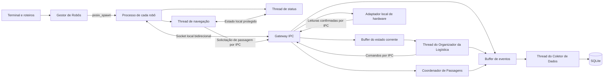
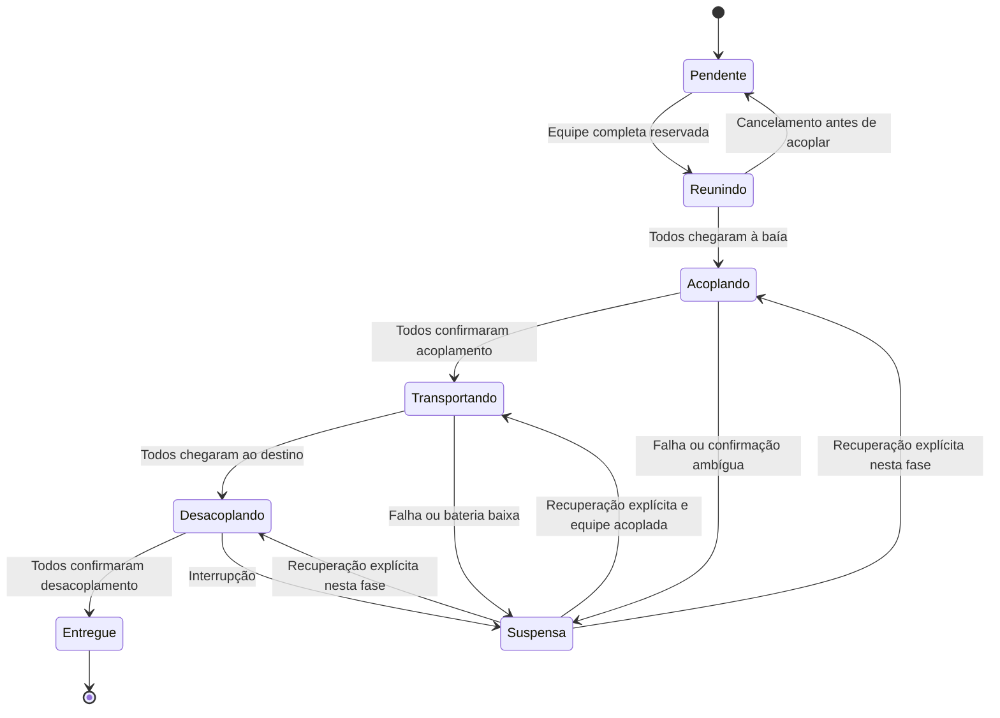

# Arquitetura do núcleo da Etapa 1

## Objetivo e situação

O núcleo implementa as tarefas de Gestor de Robôs, Navegação, Status, Organizador da Logística e Coletor de Dados. A integração utiliza processos POSIX e sockets locais. A simulação visual, a operação remota por MQTT e a análise experimental de escalonabilidade pertencem à próxima etapa.

Esta documentação descreve o código implementado. O build e 46 testes funcionais passaram no macOS, conforme [registro de validação](validacao-etapa1.md). A execução no Linux e as medições de tempo de resposta e escalonabilidade permanecem pendentes.

## Processos e tarefas

Há um executável com modo central e modo interno de robô. Cada novo robô produz um evento de disponibilidade no ponto de entrada, que chama o gestor. O gestor cria um canal e inicia um processo independente. O novo processo emite `RobotHello` e `RobotReady`; apenas após a prontidão o robô se torna elegível à logística.

No processo central, o laço principal opera o terminal e o adaptador. O gateway mantém os canais e supervisiona os filhos. O organizador e o coletor possuem threads próprias. Cada processo de robô tem um laço de recepção IPC e duas threads, de navegação e status.

## Períodos e relógios

| Tarefa | Configuração |
|---|---|
| Navegação | Intervalo nominal de 100 ms entre passos da lógica. |
| Status | Publicação periódica de 500 ms e despertar por leituras ou comandos. Leituras também disparam publicação imediata para preservar transições transitórias. |
| Organizador | Espera máxima de 200 ms e despertar por eventos. |
| Gateway | Varredura dos canais com espera máxima nominal de 10 ms entre iterações. |
| Recarga do adaptador | Cinco pontos percentuais a cada intervalo de pelo menos 500 ms. |

As esperas usam `steady_clock`, para não depender de ajustes do relógio civil. Os eventos persistidos usam época Unix em milissegundos. O texto de data e hora é exibido no fuso do ambiente de execução; para a apresentação, configure `TZ=America/Sao_Paulo` se necessário.

Os intervalos são parâmetros de implementação, sem garantia de escalonamento de tempo real. O tempo efetivo de um passo inclui IPC, confirmação e disputa por recursos. A análise de tempo de resposta depende de medições futuras.

## Estado e sincronização

| Recurso | Acessos | Proteção e regra |
|---|---|---|
| Estado local do robô | Recepção, navegação e status | Mutex; envio de mensagens fora da seção crítica. |
| Leituras ainda não contabilizadas | Recepção e status | Fila protegida pelo mutex do robô; distância considera todos os segmentos confirmados. |
| Ciclo de vida das threads | Início e parada | Mutex próprio e variável de condição para interromper esperas. |
| Socket do robô | Emissão por múltiplas tarefas | Serialização de emissão; o transporte usa mutex com prazo para a escrita. |
| Estado corrente da frota | Gateway e consumidores centrais | `FleetStateStore` com mutex, geração, revisão e sequência; consultas por cópia. |
| Cargas e missões | Organizador e consultas | Alterações pertencem ao organizador; mutex protege snapshots e processamento por passos. |
| Fila de entrada da logística | Produtores e organizador | Mutex e variável de condição. |
| Ocupação das passagens | Pedidos, sensores e consultas | Mutex; reivindicações de equipe são indivisíveis e as concessões saem após liberar a proteção. |
| Estado físico local | Gateway, injeções e laço principal | Mutex; notificações de sensores são emitidas após liberar a proteção. |
| Histórico recente | Produtores e consultas | `Buffer` com mutex; limita apenas a retenção local. |
| Fila persistente | Produtores e coletor | Mutex e variável de condição; SQLite é usado pela thread consumidora durante a operação. |

Não existe mutex C++ compartilhado entre processos. Os processos se comunicam por mensagens. O buffer central de estado é acessado pelas tarefas do processo central; o histórico de eventos tem função distinta e não substitui esse buffer.

Filas possuem limites explícitos. Excesso de capacidade gera erro e encerramento controlado, em vez de perda silenciosa de eventos importantes.

## Contrato IPC

Cada mensagem possui um cabeçalho de enquadramento de quatro bytes em ordem de rede, seguido de um payload de no máximo 65.536 bytes. Os números do payload são codificados explicitamente em oito bytes, em ordem de rede. Strings e vetores possuem comprimento explícito. Não são transmitidos ponteiros, mutexes ou a representação binária de objetos C++.

O payload contém versão, tipo, robô, geração, sequência de emissão, identificação de comando, revisão ativa, missão, carga, equipe, fase, sensores, posição, destino e os dados necessários ao comando. Uma versão incompatível, tamanho inválido, enumeração desconhecida ou dado fora dos limites encerra o canal.

| Mensagem | Sentido | Finalidade |
|---|---|---|
| `RobotHello`, `RobotReady` | Robô para central | Inicialização e prontidão. |
| `AssignMission`, `CancelMission` | Central para robô | Atribuição e cancelamento. |
| `Couple`, `Uncouple` | Central para robô | Solicitação de acoplamento e desacoplamento. |
| `PauseMission`, `ResumeMission` | Central para robô | Suspensão e recuperação explícita. |
| `CommandAck` | Robô para central | Confirmação ou rejeição de comando de controle. |
| `NavigationSetpoint` | Robô para central | Solicitação de um passo físico. |
| `SensorUpdate` | Central para robô | Leitura produzida pelo adaptador de hardware. |
| `RobotSnapshot` | Robô para central | Estado atualizado, sensores e distância. |
| `PassageRequest`, `PassageGranted` | Bidirecional | Solicitação e concessão de acesso a um trecho. |
| `Shutdown`, `RobotStopped` | Bidirecional | Encerramento cooperativo. |
| `RobotDisconnected` | Evento interno do gestor | Perda de comunicação ou término do processo. |

`PassageReleased` permanece reservado no protocolo. A liberação efetiva utiliza posição confirmada pelo adaptador, evitando confiar apenas em uma declaração de saída.

A geração identifica a instância do processo. A sequência identifica a ordem de emissão no canal. A revisão identifica o comando de controle ativo. Sensores e permissões antigos não podem executar passos após uma troca de missão ou retomada. A emissão de snapshots no processo do robô captura novamente o estado sob a serialização do envio, evitando publicar uma cópia antiga após outra mais recente.

A fila central guarda os comandos aguardando confirmação. O adaptador aplica os efeitos físicos de controle após uma confirmação aceita. Envio tem prazo de um segundo, prontidão de dois segundos e comunicação/confirmação de três segundos. A aplicação não tenta reiniciar automaticamente um robô desconectado.

## Planejamento e alocação

O mapa contém terreno e instalações estáticas; posições de robôs são mantidas separadamente. A busca BFS usa quatro vizinhos e produz caminhos sem diagonais. Retorna uma rota vazia quando a origem já é o destino e ausência de rota quando o destino é inalcançável.

Uma rota de equipe acoplada filtra passagens com capacidade inferior ao número de integrantes. A indisponibilidade temporária de um trecho é resolvida pela fila de acesso e não altera sua capacidade estrutural.

As baias são percorridas por ID. Cada uma disponibiliza a primeira carga de sua fila inicial, que é preservada sem ordenação por tamanho. Robôs são selecionados por ID entre os conectados, disponíveis, sem falha e sem reserva. A energia precisa cobrir coleta, transporte, acesso a um carregador e margem superior ao limiar de bateria baixa.

Uma equipe é reservada por inteiro. A ausência de integrantes ou de uma rota deixa a carga pendente, com motivo consultável. Outras baias podem continuar sendo atendidas. A política busca previsibilidade e não otimização global de tempo ou distância.

## Ciclo de missão

No transporte, os integrantes compartilham posição lógica e rota. Cada um propõe o mesmo número de passo. O adaptador só atualiza a posição após reunir propostas compatíveis de todos e confirmar que estão aptos. A ocupação de uma passagem corresponde à quantidade de robôs da equipe.

A carga é considerada entregue após o desacoplamento confirmado de todos. A logística então libera os robôs e disponibiliza a próxima caixa da baía.

## Passagens restritas

Cada trecho possui região, capacidade, direção corrente, reivindicações concedidas e fila de espera. Uma equipe pede todas as vagas necessárias de forma indivisível. Requisições de fluxo oposto aguardam o esvaziamento do trecho. A fila impede que novos pedidos compatíveis ultrapassem um pedido oposto que já esteja esperando.

Entrar exige concessão. Sair exige leitura de posição fora do trecho. Um robô com falha ou processo interrompido continua ocupando sua posição física. A remoção precisa ser explícita e não é permitida para robô com carga acoplada.

Os mapas de demonstração têm áreas livres entre trechos distintos. Isso evita que o modelo precise reter dois recursos de passagem enquanto aguarda um terceiro. O controle não implementa colisão geral nas áreas abertas.

## Falhas e energia

Falha impede novos movimentos. Antes de qualquer acoplamento, a reserva pode ser cancelada e a carga volta à fila. Após início do acoplamento ou em situação ambígua, a equipe é suspensa. Não ocorre substituição automática de integrante acoplado.

A retomada exige integrantes conectados, mesma geração, ausência de falha, bateria acima do limiar e confirmação do estado suspenso. A posição lógica deve ser consistente. Uma rota de transporte é recalculada a partir da posição recuperada.

Robôs desacoplados com bateria baixa ou energia insuficiente para uma missão elegível são encaminhados a um carregador alcançável. O retorno à disponibilidade ocorre em 100%. Energia zero sem alcance do carregador exige intervenção por injeção controlada no adaptador.

Bateria baixa durante transporte acoplado suspende a equipe. O adaptador permite restaurar a leitura e autorizar retomada. Essa intervenção é um recurso da demonstração, sem representar uma operação física completa de troca ou recarga de bateria junto à carga.

## Persistência e encerramento

O esquema mantém os códigos de eventos preexistentes e adiciona metadados por migração compatível. Registros antigos continuam legíveis e têm metadados novos nulos. O banco aceita a versão de esquema zero ou um; versões futuras incompatíveis são rejeitadas.

| Tabela | Conteúdo |
|---|---|
| `runs` | Início, término e situação da execução. |
| `robot_events` | Evento, timestamp, posição, produtor, geração, sequência, carga e missão. |
| `cargo_transports` | Coleta, entrega, baía e destino por missão. |
| `cargo_members` | Relação dos robôs participantes do transporte. |

Cada evento é gravado em transação. Coleta e entrega atualizam a rastreabilidade da missão e seus participantes. A identidade do produtor evita duplicações do mesmo evento. Falha de escrita chega ao processo principal e encerra a execução de forma controlada.

A parada interrompe o organizador, solicita encerramento dos processos, recebe suas mensagens finais, recolhe os filhos e só então drena a fila SQLite. O gestor aguarda encerramento cooperativo e, se necessário, usa `SIGTERM` após dois segundos e `SIGKILL` após três segundos. O encerramento abrupto de todo o programa não possui a mesma garantia de drenagem.

## Continuidade para a Etapa 2

A interface `HardwareAdapter` é o ponto de substituição do hardware local por simulação conectada. Os eventos de disponibilidade podem ser produzidos por um subscriber MQTT no lugar dos comandos de terminal. Os snapshots da frota podem alimentar a interface de operação.

A Etapa 2 ainda precisa de tópicos e payloads MQTT, reconexão ao broker, interface gráfica, operações manual/automática e análise experimental de tempo de resposta e escalonabilidade. Os arquivos antigos de simulação e MQTT continuam sendo esboços da próxima etapa e não fazem parte do fluxo executável do núcleo atual.
