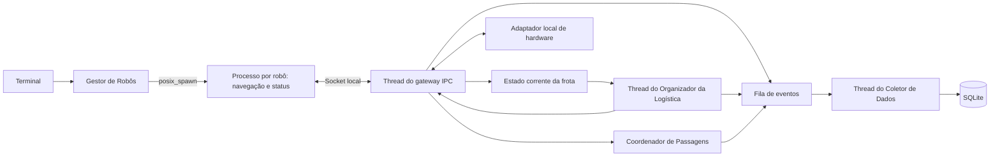

# Arquitetura da Etapa 1

## Componentes e comunicação

Um executável opera como aplicação central ou processo de robô. O gestor cria cada robô com `posix_spawn` e `socketpair`; ele só fica disponível após confirmar prontidão. Cada robô possui um laço de recepção e duas threads, de navegação e status.



O processo central concentra terminal, adaptador, gateway, logística e coletor. O adaptador recebe setpoints e gera sensores confirmados, separando posição solicitada de posição observada.

O protocolo IPC usa enquadramento de quatro bytes e payload de até 64 KiB, com serialização explícita. Transporta inicialização, comandos e confirmações, sensores, snapshots, permissões e encerramento. Geração, sequência, missão e revisão permitem rejeitar mensagens antigas. O envio tem prazo de um segundo, a prontidão de dois e a comunicação/confirmação de três segundos.

IPC conecta os processos locais da Etapa 1. Na Etapa 2, MQTT conectará o controle ao simulador e às interfaces por tópicos e broker, substituindo a ligação direta ao adaptador local.

## Estado e sincronização

| Recurso | Responsabilidade e proteção |
|---|---|
| Estado e sensores do robô | Mutex local; leituras pendentes preservam todos os movimentos para calcular distância. |
| Estado corrente da frota | `FleetStateStore` com mutex; snapshots por cópia e rejeição de gerações, revisões e sequências antigas. |
| Cargas e equipes | Organizador concentra alterações; mutex protege consultas e fila com variável de condição recebe eventos. |
| Passagens e hardware | Mutex por componente; concessões e sensores são emitidos após liberar a proteção. |
| Canais IPC | Gateway central possui os sockets; filas de envio e escrita serializada evitam misturar mensagens. |
| Histórico e persistência | `Buffer` sincronizado e fila com variável de condição; coletor grava no SQLite. |

Mutexes não são compartilhados entre processos. Envios ocorrem fora dos mutexes de domínio; esperas são interrompíveis no encerramento. Filas limitadas sinalizam excesso em vez de descartar eventos silenciosamente.

Períodos nominais: navegação de 100 ms, status de 500 ms e organizador de 200 ms, com despertar por eventos onde aplicável. Esperas usam `steady_clock`; eventos usam época Unix em milissegundos. Esses períodos não constituem garantia de escalonamento em tempo real.

## Fluxo de operação

1. **Alocação:** baias e robôs são percorridos por ID, preservando a fila de cargas de cada baía. A equipe de um a quatro integrantes é reservada por inteiro, considerando conectividade, falha, disponibilidade e energia para coleta, entrega e acesso ao carregador.
2. **Rotas:** BFS com movimentos ortogonais respeita obstáculos e capacidade estrutural das passagens. Terreno e instalações são separados da posição dos robôs. Sem equipe ou rota, a carga permanece pendente com motivo consultável.
3. **Transporte:** a missão passa por reunião na baía, acoplamento, transporte e desacoplamento. Cada fase exige confirmação de todos. Durante o transporte, o adaptador avança a posição lógica somente após propostas compatíveis do mesmo passo por toda a equipe. A entrega exige desacoplamento completo.
4. **Passagens:** a reserva da equipe é indivisível e consome uma vaga por integrante. Fluxos opostos aguardam o esvaziamento, respeitando a fila. A liberação exige posição de saída confirmada; falha ou desconexão preserva a ocupação física.
5. **Falhas e recarga:** falha bloqueia movimentos. Antes do acoplamento, a carga pode voltar à fila; após seu início ou em situação ambígua, a missão é suspensa. A retomada exige comando explícito e sensores atuais de toda a equipe. Bateria de até 15% encaminha o robô desacoplado à recarga; acoplado, suspende a equipe. O adaptador consome um ponto por célula e recarrega cinco a cada 500 ms, liberando o robô em 100%.

## Persistência e encerramento

O banco padrão é `logs/etapa1.db`. A migração preserva registros e códigos de eventos antigos. As tabelas `runs`, `robot_events`, `cargo_transports` e `cargo_members` relacionam execução, eventos, missão, carga, baía, destino e participantes. Falha de escrita provoca encerramento controlado.

A parada interrompe novos despachos, solicita encerramento dos robôs, recebe mensagens finais, recolhe os filhos e drena a fila do coletor. O gestor escala para `SIGTERM` após dois segundos e `SIGKILL` após três, quando necessário. Desconexão não provoca reinício automático.

Para inspecionar entregas e participantes de uma demonstração:

```sql
SELECT t.mission_id, t.cargo_id, t.bay_id, t.destination,
       t.status, m.robot_id, t.pickup_at_ms, t.delivered_at_ms
FROM cargo_transports AS t
JOIN cargo_members AS m
  ON m.run_id = t.run_id AND m.mission_id = t.mission_id
WHERE t.run_id = (SELECT MAX(id) FROM runs)
ORDER BY t.mission_id, m.robot_id;
```

## Validação e entrega

Em 18/10/2026, o código `66016ea853a5d7ee906ca2ada4c3253e88708b0a` passou no build e nos **46 testes: 37 unitários e 9 de integração**. Ambiente: macOS 14.4.1 arm64, Apple Clang 15.0.0, CMake 4.4.4, SQLite 3.43.2 e GoogleTest 1.14.0. Comandos no [README](../README.md).

Os unitários cobrem protocolo, estado, rotas, barreiras, passagens, hardware, falhas, energia e persistência. As integrações executam os oito cenários com processos reais e um caso de encerramento durante operação. Verificam recolhimento de filhos, término da execução no banco e participantes dos transportes. A inspeção final não encontrou robôs remanescentes; o banco versionado foi preservado.

Logs locais, ignorados pelo Git: `build/evidencias/ctest-final.log` e `build/evidencias/testes-finais.log`. Os bancos dos testes são temporários; para evidência permanente, execute um cenário com `--banco logs/etapa1-demo.db`. A suíte levou 103,95 segundos, sem representar uma medição de latência de controle.

Para concluir o relatório: reproduzir a validação no Linux, selecionar logs/PIDs/consultas SQLite, exportar o diagrama, redigir o PDF e conferir as orientações do Moodle. O CI está configurado somente para Ubuntu e ainda não teve execução registrada.

O transporte atual é lógico: integrantes compartilham a posição da carga, não há controle geral de colisões em áreas abertas nem transferência física automática de carga após falha. A Etapa 2 deverá integrar MQTT e interfaces gráficas pelo adaptador e realizar a análise de tempo de resposta e escalonabilidade.
