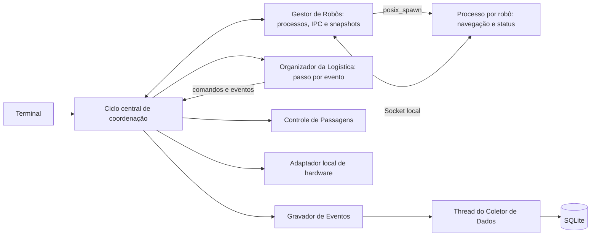

# Arquitetura da Etapa 1

## Componentes e comunicação

Um executável opera como aplicação central ou processo de robô. O Gestor de Robôs cria cada processo com `posix_spawn` e `socketpair`, mantém seu estado corrente e só o disponibiliza após confirmar prontidão. Cada processo de robô possui um laço de recepção e duas threads, de navegação e status.



O ciclo central recebe mensagens do Gestor, atualiza passagens e adaptador, entrega eventos e snapshots à logística, envia comandos aos robôs e encaminha eventos ao gravador. O adaptador recebe setpoints e devolve sensores confirmados, separando posição solicitada de posição observada. O coletor é a única thread central dedicada, pois a gravação em disco não deve bloquear o ciclo.

O protocolo IPC usa enquadramento de quatro bytes e payload de até 64 KiB, com serialização explícita. Transporta inicialização, comandos e confirmações, sensores, snapshots, permissões e encerramento. Geração, sequência, missão e revisão permitem rejeitar mensagens antigas. O envio tem prazo de um segundo, a prontidão de dois e a comunicação/confirmação de três segundos.

IPC conecta os processos locais da Etapa 1. Na Etapa 2, MQTT conectará o controle ao simulador e às interfaces por tópicos e broker, substituindo a ligação direta ao adaptador local.

## Estado e sincronização

| Recurso | Responsabilidade e proteção |
|---|---|
| Estado e sensores do robô | Mutex local protege os dados compartilhados pelas threads de navegação e status; leituras pendentes preservam movimentos para calcular distância. |
| Estado corrente da frota | Mantido pelo Gestor e atualizado no ciclo central; snapshots são retornados por cópia, com validação de geração, revisão e sequência. |
| Cargas, equipes, passagens e hardware local | Acesso exclusivo pelo ciclo central; não precisam de filas, callbacks ou mutexes entre módulos. |
| Canais IPC | O Gestor central possui os sockets e processa mensagens sem thread própria; as threads do robô serializam seus envios. |
| Eventos e SQLite | O gravador encaminha eventos à fila protegida do coletor, que os grava em sua thread. |

Mutexes não são compartilhados entre processos. O ciclo central executa o tratamento de mensagens, a simulação e as decisões de logística em sequência. O estado de cada robô continua sincronizado entre suas duas threads; a fila do coletor protege o acesso entre a aplicação e a thread de persistência.

Períodos nominais: navegação de 100 ms, status de 500 ms e processamento da logística de 200 ms quando ociosa, com avanço antecipado quando há eventos. Esperas usam `steady_clock`; eventos usam época Unix em milissegundos. Esses períodos não constituem garantia de escalonamento em tempo real.

## Fluxo de operação

1. **Recepção:** o ciclo central pede ao Gestor mensagens IPC disponíveis e snapshots atualizados. O Gestor mantém processos, PID, geração, canal e estado corrente, rejeitando mensagens antigas.
2. **Alocação:** baias e robôs são percorridos por ID, preservando a fila de cargas de cada baía. A equipe de um a quatro integrantes é reservada por inteiro, considerando conectividade, falha, disponibilidade e energia para coleta, entrega e acesso ao carregador.
3. **Rotas:** BFS com movimentos ortogonais respeita obstáculos e capacidade estrutural das passagens. Terreno e instalações são separados da posição dos robôs. Sem equipe ou rota, a carga permanece pendente com motivo consultável.
4. **Transporte:** a missão passa por reunião na baía, acoplamento, transporte e desacoplamento. Cada fase exige confirmação de todos. Durante o transporte, o adaptador avança a posição lógica somente após propostas compatíveis do mesmo passo por toda a equipe. A entrega exige desacoplamento completo.
5. **Passagens:** a reserva da equipe é indivisível e consome uma vaga por integrante. Fluxos opostos aguardam o esvaziamento, respeitando a fila. A liberação exige posição de saída confirmada; falha ou desconexão preserva a ocupação física.
6. **Falhas e recarga:** falha bloqueia movimentos. Antes do acoplamento, a carga pode voltar à fila; após seu início ou em situação ambígua, a missão é suspensa. A retomada exige comando explícito e sensores atuais de toda a equipe. Bateria de até 15% encaminha o robô desacoplado à recarga; acoplado, suspende a equipe. O adaptador consome um ponto por célula e recarrega cinco a cada 500 ms, liberando o robô em 100%.

## Persistência e encerramento

O banco padrão é `logs/etapa1.db`. A migração preserva registros e códigos de eventos antigos. As tabelas `runs`, `robot_events`, `cargo_transports` e `cargo_members` relacionam execução, eventos, missão, carga, baía, destino e participantes. Falha de escrita provoca encerramento controlado.

A parada interrompe novos despachos, solicita encerramento dos robôs, recebe mensagens finais, recolhe os filhos e drena a fila do coletor. O gestor escala para `SIGTERM` após dois segundos e `SIGKILL` após três, quando necessário. Desconexão não provoca reinício automático.

Para inspecionar entregas e participantes de uma demonstração:

```sql
SELECT t.mission_id, t.cargo_id, t.bay_id, t.destination,
       t.status, m.robot_id, t.pickup_at_ms, t.delivered_at_ms
FROM cargo_transports AS t
JOIN cargo_members AS m
  ON m.run_id = t.run_id AND m.mission_id = t.mission_id
WHERE t.run_id = (SELECT MAX(id) FROM runs)
ORDER BY t.mission_id, m.robot_id;
```

## Validação e entrega

Em 18/10/2026, o build e os **48 testes: 39 unitários e 9 de integração** passaram após a centralização do ciclo. Ambiente: macOS 14.4.1 arm64, Apple Clang 15.0.0, CMake 4.4.4, SQLite 3.43.2 e GoogleTest 1.14.0. Comandos no [README](../README.md).

### 1. Testes de Unidade e Lógica Interna
* **`test_warehouse.cpp`**: Valida a integridade do mapa estático do armazém (`MapaGalpao`) e o algoritmo de planejamento de rotas (`PlanejadorRotas`), garantindo o desvio de obstáculos/paredes e o cálculo correto de distâncias.
* **`test_robot.cpp`**: Testa o comportamento autônomo individual de cada agente robô (`AgenteRobo`), incluindo máquina de estados, validação de permissões de trecho, rejeição de revisões obsoletas e ciclos de recarga de bateria.
* **`test_passages_hardware.cpp`**: Verifica a coordenação de passagens restritas/túneis de capacidade limitada (`ControlePassagens`) e o adaptador de hardware local, assegurando o movimento sincronizado de equipes em corredores estreitos.
* **`test_logistics.cpp`**: Valida o organizador de logística (`OrganizadorLogistica`), gerando a alocação de cargas, formação de equipes cooperativas, tratamento de suspensão por falhas parciais e retomada de missões.

### 2. Testes de Comunicação, Estado e Persistência
* **`test_ipc.cpp`**: Garante a serialização e desserialização binária de mensagens do protocolo IPC, a remontagem segura de *frames* fragmentados via *sockets* Unix e a consistência estrita da máquina de estados global da frota (`EstadoFrota`).
* **`test_data_collector.cpp` & `test_buffer_data_collector.cpp`**: Validam o coletor assíncrono de eventos e o buffer circular de telemetria direcionados ao SQLite, assegurando que múltiplos robôs concorrentes não corrompam os dados.
* **`test_storage_migration.cpp`**: Testa a retrocompatibilidade e a migração de esquemas legados de bases de dados SQLite, além de resiliência contra falhas de gravação.

### 3. Testes de Integração
* **`test_integration.cpp`**: Executa cenários completos de simulação de ponta a ponta (`base`, `cooperativo`, `falhas`, etc.) com sub-processos reais de robôs (`fork`/`exec`), garantindo o encerramento limpo sem processos zumbis e a integridade final dos relatórios no banco de dados.
